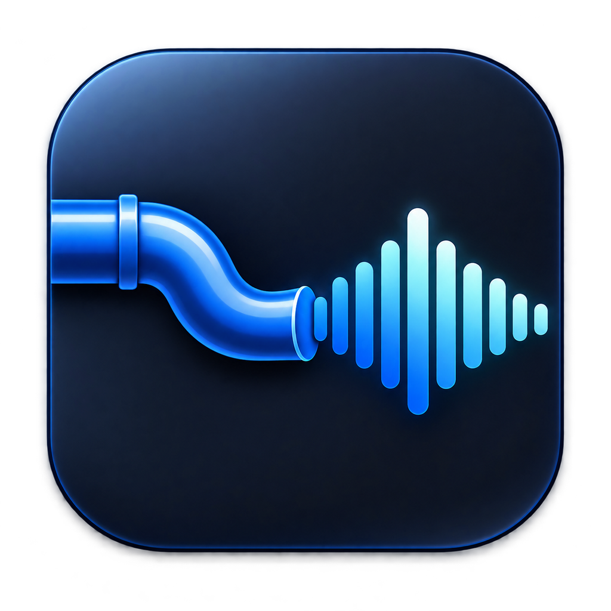
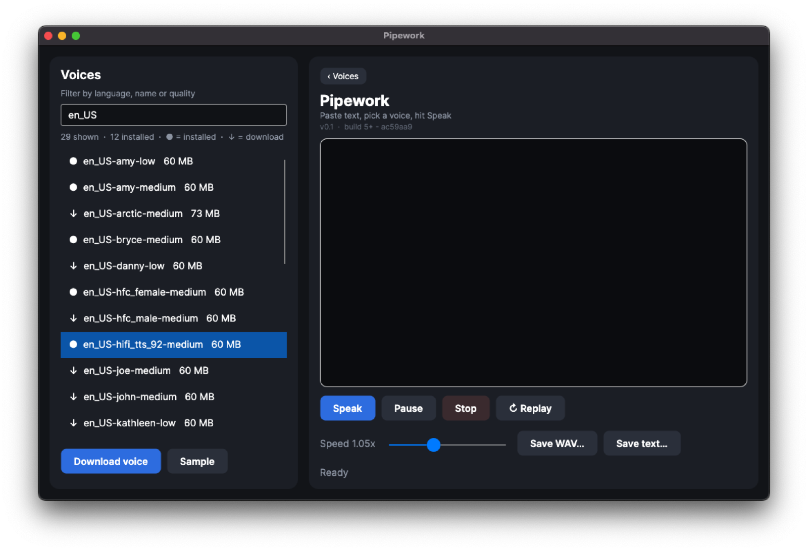
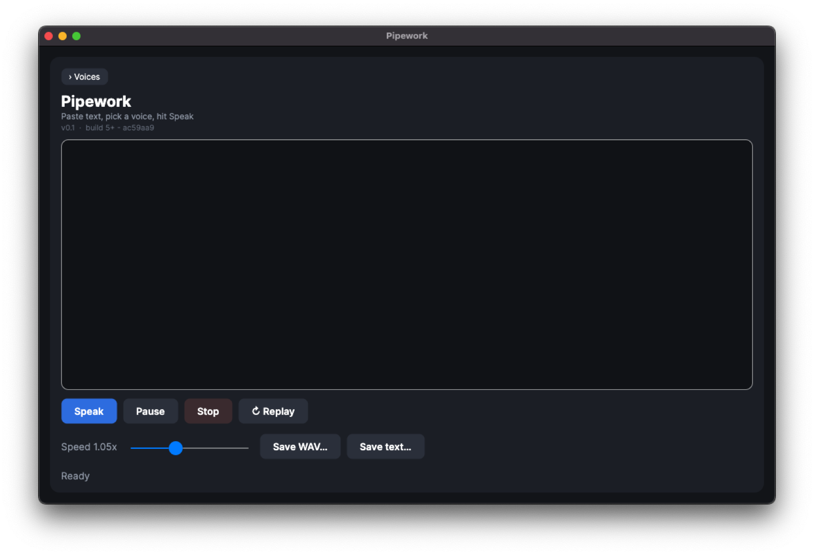

  

# Pipework

      

A small macOS app for Piper text-to-speech. Paste text, browse and download Piper voices, sample them, and have it read to you. Built with C# on .NET 8 and Avalonia, so it runs on older Macs (I wrote it on Monterey).

  
  

## What it does

- Browse the full Piper voice catalog, filter by language, name or quality, with installed voices marked
- Download voices in-app, and sample any voice. Previews are cached so repeat samples play instantly
- Speak whatever you paste, with Pause, Stop, Replay and a speed slider (0.5x to 2x)
- Live synthesis timer, then a summary with word count, time, clip length and file size
- Save the last audio as a WAV, or save the text in the box as a .txt
- Collapse the voices pane to give the text box the whole window
- Remembers your voice, speed, filter and pane state between launches
- Built-in guide to Piper, voice names, quality tiers and voice licensing

## Settings

- **Samples cache:** see how many previews are stored and how much space they use, and clear them
- **Double-dash pause:** choose what `--` between words becomes (comma, period or ellipsis), or leave it as typed
- **Custom pause rules:** add a symbol or word and a pause type. Symbols are replaced by the pause, and words keep their text and get the pause after them

Pause length differs between voices, since each one learned its own timing, so the longest option can change from voice to voice. Pause rules only change the text sent to Piper, never the text in your box.

## Download

Grab the latest `Pipework-vX-macOS-x64.zip` from the [Releases](https://github.com/smokeluce/pipework/releases) page, unzip it, and drag `Pipework.app` to Applications. You still need Piper installed (see below).

The app is signed ad hoc rather than with an Apple Developer ID, so the first launch shows a "can't verify the developer" warning. Right-click the app and choose Open, or run `xattr -dr com.apple.quarantine /Applications/Pipework.app` once. The download is for Intel Macs. On Apple Silicon, build it yourself with `RID=osx-arm64 ./build-app.sh`.

## Requirements

- macOS 12 (Monterey) or newer
- .NET 8 SDK (only to build from source)
- Piper, installed with `pip3 install piper-tts`

Pipework looks for `piper` on your shell's PATH. If yours lives somewhere odd, set `PIPEWORK_PIPER` to the full path.

## Run it

    git clone https://github.com/smokeluce/pipework.git
    cd pipework
    dotnet run

Voices are stored in `~/.local/share/piper-voices`, the same folder Piper's own tooling uses, so voices you already have show up as installed. Settings, cached samples and the voice list live in `~/Library/Application Support/Pipework`.

## Notes

- The build number in the window is the git commit count, with a `+` when there are uncommitted changes.
- Speed is applied at playback, so saved WAVs are always at normal speed.
- Pause stops the player and Resume picks up from just before where it stopped, with a short silent lead-in so it doesn't pop.
- `./build-app.sh` builds `dist/Pipework.app` and a release zip. Set `RID=osx-arm64` for Apple Silicon.

## Roadmap

- Windows and Linux builds, which need playback, paths and Piper discovery moved behind a small platform layer
- Sample on another voice should stop the current one and switch

## License

MIT, see [LICENSE](LICENSE). Copyright (c) 2026 Paul Swonger.

## Credits

Piper is from the Rhasspy project, and the voices come from [rhasspy/piper-voices](https://huggingface.co/rhasspy/piper-voices) on Hugging Face. Each voice has its own license, so check before using one in anything you ship.
